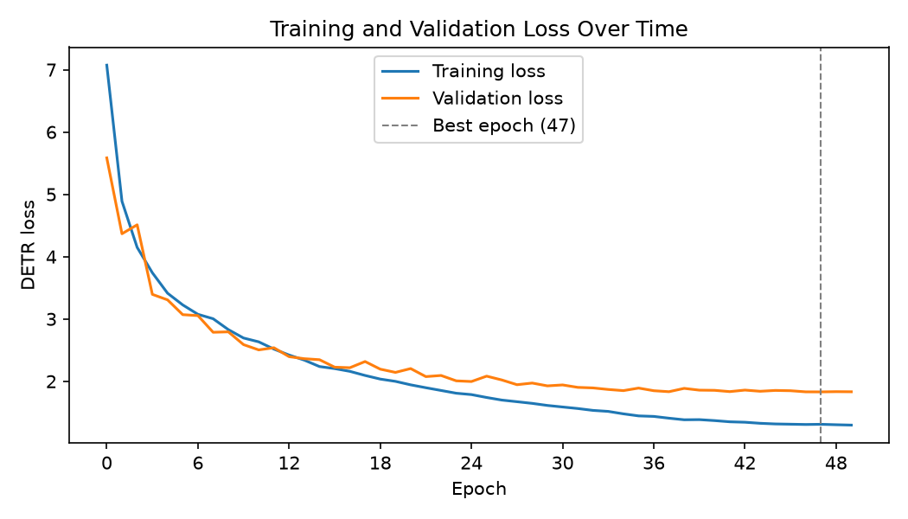

# GalaxyDETR training report: `galaxy_detr_20261105_111705`

## Results

| | |
|---|---|
| **Test accuracy** (held out, scored once) | **0.8275** |
| Test mean box GIoU | 0.9195 |
| Validation accuracy (picked the checkpoint) | 0.8241 |
| Validation mean box GIoU (top query vs. pseudo-label box) | 0.9184 |
| Best epoch | 47 of 50 (0-indexed) |
| Best validation loss | 1.83010 |
| Average time per epoch | 77.1 s |
| Total training time | 64.3 min |
| Saved weights | `models/galaxy_detr_20261105_111705.pth` |

> Report rebuilt with make_report_detr.py on 2026-11-05 13:34. Validation/test results were recomputed from the saved checkpoint.

## Setup

| | |
|---|---|
| Date | 2026-11-05 11:17 |
| Device | NVIDIA L40S (device used to rebuild this report) |
| Dataset | `data/Galaxy10_DECals.h5` |
| Train / validation / test images | 12414 / 2661 / 2661 (stratified, seed 42) |
| Training flips | on |
| Backbone | mobilenetv4_conv_small (from scratch) |
| Transformer | d_model 128, 4 heads, 3 enc + 3 dec layers, FFN 512, 10 queries |
| Trainable parameters | 2,699,375 |
| Epochs / batch size | 50 / 32 |
| Learning rate (backbone / rest) | 0.0001 / 0.0003 |

## Test set (held out)

Never used for training or for choosing the checkpoint; scored once at the end. This is the number to report.

Accuracy **0.8275**, mean box GIoU 0.9195, 2661 images.

| Class | Images | Precision | Recall |
|---|---|---|---|
| disturbed | 162 | 0.590 | 0.364 |
| merging | 278 | 0.865 | 0.878 |
| round_smooth | 397 | 0.908 | 0.940 |
| in_between_round_smooth | 304 | 0.901 | 0.928 |
| cigar_smooth | 50 | 0.724 | 0.840 |
| barred_spiral | 307 | 0.872 | 0.824 |
| unbarred_tight_spiral | 274 | 0.720 | 0.741 |
| unbarred_loose_spiral | 394 | 0.687 | 0.728 |
| edge_on_no_bulge | 214 | 0.921 | 0.921 |
| edge_on_with_bulge | 281 | 0.894 | 0.932 |

Confusion matrix (rows = true class, columns = predicted class):

| true \ pred | 0 | 1 | 2 | 3 | 4 | 5 | 6 | 7 | 8 | 9 |
|---|---|---|---|---|---|---|---|---|---|---|
| 0 disturbed | 59 | 8 | 14 | 15 | 4 | 7 | 4 | 41 | 3 | 7 |
| 1 merging | 6 | 244 | 5 | 3 | 0 | 5 | 3 | 7 | 0 | 5 |
| 2 round_smooth | 0 | 4 | 373 | 1 | 0 | 2 | 11 | 6 | 0 | 0 |
| 3 in_between_round_smooth | 6 | 2 | 3 | 282 | 5 | 0 | 3 | 2 | 0 | 1 |
| 4 cigar_smooth | 0 | 0 | 0 | 2 | 42 | 1 | 0 | 1 | 2 | 2 |
| 5 barred_spiral | 4 | 4 | 1 | 2 | 2 | 253 | 8 | 28 | 3 | 2 |
| 6 unbarred_tight_spiral | 4 | 1 | 9 | 3 | 2 | 4 | 203 | 44 | 4 | 0 |
| 7 unbarred_loose_spiral | 11 | 15 | 5 | 4 | 2 | 17 | 48 | 287 | 0 | 5 |
| 8 edge_on_no_bulge | 5 | 0 | 0 | 0 | 0 | 0 | 1 | 2 | 197 | 9 |
| 9 edge_on_with_bulge | 5 | 4 | 1 | 1 | 1 | 1 | 1 | 0 | 5 | 262 |

## Validation set

Used every epoch to pick the best checkpoint, so its accuracy is slightly optimistic.

Accuracy **0.8241**, mean box GIoU 0.9184, 2661 images.

| Class | Images | Precision | Recall |
|---|---|---|---|
| disturbed | 162 | 0.558 | 0.296 |
| merging | 278 | 0.876 | 0.888 |
| round_smooth | 397 | 0.937 | 0.929 |
| in_between_round_smooth | 304 | 0.861 | 0.934 |
| cigar_smooth | 50 | 0.783 | 0.720 |
| barred_spiral | 307 | 0.861 | 0.808 |
| unbarred_tight_spiral | 275 | 0.756 | 0.789 |
| unbarred_loose_spiral | 394 | 0.665 | 0.741 |
| edge_on_no_bulge | 213 | 0.906 | 0.859 |
| edge_on_with_bulge | 281 | 0.876 | 0.957 |

Confusion matrix (rows = true class, columns = predicted class):

| true \ pred | 0 | 1 | 2 | 3 | 4 | 5 | 6 | 7 | 8 | 9 |
|---|---|---|---|---|---|---|---|---|---|---|
| 0 disturbed | 48 | 3 | 9 | 19 | 5 | 13 | 6 | 53 | 2 | 4 |
| 1 merging | 0 | 247 | 2 | 6 | 0 | 6 | 1 | 12 | 1 | 3 |
| 2 round_smooth | 2 | 5 | 369 | 1 | 0 | 2 | 11 | 7 | 0 | 0 |
| 3 in_between_round_smooth | 4 | 4 | 3 | 284 | 2 | 0 | 2 | 5 | 0 | 0 |
| 4 cigar_smooth | 0 | 1 | 0 | 5 | 36 | 0 | 0 | 0 | 1 | 7 |
| 5 barred_spiral | 5 | 8 | 1 | 2 | 3 | 248 | 7 | 28 | 1 | 4 |
| 6 unbarred_tight_spiral | 2 | 3 | 7 | 5 | 0 | 4 | 217 | 32 | 3 | 2 |
| 7 unbarred_loose_spiral | 20 | 7 | 3 | 7 | 0 | 11 | 39 | 292 | 6 | 9 |
| 8 edge_on_no_bulge | 4 | 2 | 0 | 0 | 0 | 4 | 4 | 7 | 183 | 9 |
| 9 edge_on_with_bulge | 1 | 2 | 0 | 1 | 0 | 0 | 0 | 3 | 5 | 269 |

## Per-epoch losses

| Epoch | Train loss | Val loss | Time (s) | |
|---|---|---|---|---|
| 0 | 7.07317 | 5.58524 | 89 | best so far |
| 1 | 4.88858 | 4.36751 | 72 | best so far |
| 2 | 4.14881 | 4.51118 | 72 |  |
| 3 | 3.74185 | 3.39504 | 72 | best so far |
| 4 | 3.41385 | 3.30674 | 72 | best so far |
| 5 | 3.22579 | 3.06934 | 72 | best so far |
| 6 | 3.07485 | 3.05391 | 72 | best so far |
| 7 | 3.00383 | 2.78690 | 72 | best so far |
| 8 | 2.82952 | 2.79360 | 72 |  |
| 9 | 2.69469 | 2.58862 | 72 | best so far |
| 10 | 2.63322 | 2.50394 | 72 | best so far |
| 11 | 2.51685 | 2.53857 | 72 |  |
| 12 | 2.42138 | 2.39522 | 72 | best so far |
| 13 | 2.33986 | 2.36255 | 72 | best so far |
| 14 | 2.23674 | 2.34644 | 72 | best so far |
| 15 | 2.20381 | 2.22664 | 72 | best so far |
| 16 | 2.15963 | 2.21809 | 72 | best so far |
| 17 | 2.09382 | 2.31730 | 72 |  |
| 18 | 2.03566 | 2.19471 | 72 | best so far |
| 19 | 1.99900 | 2.14295 | 72 | best so far |
| 20 | 1.94323 | 2.20422 | 72 |  |
| 21 | 1.89695 | 2.07537 | 72 | best so far |
| 22 | 1.85292 | 2.09339 | 72 |  |
| 23 | 1.80873 | 2.00728 | 71 | best so far |
| 24 | 1.78668 | 1.99647 | 73 | best so far |
| 25 | 1.74032 | 2.08265 | 81 |  |
| 26 | 1.69870 | 2.02133 | 87 |  |
| 27 | 1.67244 | 1.94543 | 85 | best so far |
| 28 | 1.64577 | 1.97181 | 87 |  |
| 29 | 1.61255 | 1.92676 | 88 | best so far |
| 30 | 1.58774 | 1.94167 | 83 |  |
| 31 | 1.56318 | 1.90258 | 86 | best so far |
| 32 | 1.53311 | 1.89380 | 86 | best so far |
| 33 | 1.51705 | 1.86909 | 80 | best so far |
| 34 | 1.47784 | 1.85036 | 81 | best so far |
| 35 | 1.44487 | 1.89129 | 81 |  |
| 36 | 1.43653 | 1.84893 | 79 | best so far |
| 37 | 1.40801 | 1.83313 | 80 | best so far |
| 38 | 1.38270 | 1.88647 | 79 |  |
| 39 | 1.38494 | 1.85790 | 80 |  |
| 40 | 1.36951 | 1.85504 | 79 |  |
| 41 | 1.35025 | 1.83460 | 81 |  |
| 42 | 1.34318 | 1.85889 | 80 |  |
| 43 | 1.32614 | 1.84005 | 80 |  |
| 44 | 1.31574 | 1.85340 | 80 |  |
| 45 | 1.31146 | 1.84882 | 80 |  |
| 46 | 1.30711 | 1.83083 | 80 | best so far |
| 47 | 1.31025 | 1.83010 | 79 | best so far |
| 48 | 1.30309 | 1.83377 | 79 |  |
| 49 | 1.29726 | 1.83204 | 79 |  |

Full config: [`config.yaml`](config.yaml). Machine-readable numbers: [`metrics.json`](metrics.json).
