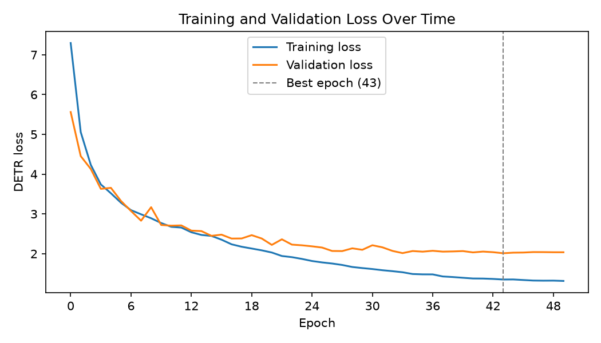

# GalaxyDETR training report: `galaxy_detr_20261105_134718`

## Results

| | |
|---|---|
| **Test accuracy** (held out, scored once) | **0.8189** |
| Test mean box GIoU | 0.9136 |
| Validation accuracy (picked the checkpoint) | 0.8253 |
| Validation mean box GIoU (top query vs. pseudo-label box) | 0.9133 |
| Best epoch | 43 of 50 (0-indexed) |
| Best validation loss | 2.01186 |
| Average time per epoch | 82.6 s |
| Total training time | 68.8 min |
| Saved weights | `models/galaxy_detr_20261105_134718.pth` |

## Setup

| | |
|---|---|
| Date | 2026-11-05 13:47 |
| Device | NVIDIA L40S |
| Dataset | `data/Galaxy10_DECals.h5` |
| Train / validation / test images | 12414 / 2661 / 2661 (stratified, seed 42) |
| Training flips | on |
| Batch sampling (training) | weighted random sampler, power 1.0 (class-balanced; validation/test keep the natural mix) |
| Backbone | mobilenetv4_conv_small (ImageNet-pretrained) |
| Transformer | d_model 128, 4 heads, 3 enc + 3 dec layers, FFN 512, 10 queries |
| Trainable parameters | 2,699,375 |
| Epochs / batch size | 50 / 32 |
| Learning rate (backbone / rest) | 0.0001 / 0.0003 |

## Test set (held out)

Never used for training or for choosing the checkpoint; scored once at the end. This is the number to report.

Accuracy **0.8189**, mean box GIoU 0.9136, 2661 images.

| Class | Images | Precision | Recall |
|---|---|---|---|
| disturbed | 162 | 0.447 | 0.444 |
| merging | 278 | 0.840 | 0.885 |
| round_smooth | 397 | 0.904 | 0.929 |
| in_between_round_smooth | 304 | 0.904 | 0.895 |
| cigar_smooth | 50 | 0.690 | 0.800 |
| barred_spiral | 307 | 0.872 | 0.818 |
| unbarred_tight_spiral | 274 | 0.748 | 0.759 |
| unbarred_loose_spiral | 394 | 0.724 | 0.680 |
| edge_on_no_bulge | 214 | 0.923 | 0.902 |
| edge_on_with_bulge | 281 | 0.881 | 0.925 |

Confusion matrix (rows = true class, columns = predicted class):

| true \ pred | 0 | 1 | 2 | 3 | 4 | 5 | 6 | 7 | 8 | 9 |
|---|---|---|---|---|---|---|---|---|---|---|
| 0 disturbed | 72 | 8 | 13 | 12 | 5 | 8 | 7 | 25 | 3 | 9 |
| 1 merging | 6 | 246 | 4 | 4 | 0 | 5 | 1 | 7 | 0 | 5 |
| 2 round_smooth | 4 | 7 | 369 | 1 | 0 | 2 | 8 | 6 | 0 | 0 |
| 3 in_between_round_smooth | 15 | 7 | 3 | 272 | 4 | 0 | 3 | 0 | 0 | 0 |
| 4 cigar_smooth | 1 | 0 | 1 | 1 | 40 | 1 | 0 | 1 | 1 | 4 |
| 5 barred_spiral | 14 | 5 | 1 | 2 | 2 | 251 | 8 | 19 | 2 | 3 |
| 6 unbarred_tight_spiral | 4 | 1 | 14 | 5 | 1 | 0 | 208 | 39 | 2 | 0 |
| 7 unbarred_loose_spiral | 37 | 14 | 3 | 3 | 1 | 21 | 41 | 268 | 3 | 3 |
| 8 edge_on_no_bulge | 4 | 0 | 0 | 0 | 2 | 0 | 1 | 3 | 193 | 11 |
| 9 edge_on_with_bulge | 4 | 5 | 0 | 1 | 3 | 0 | 1 | 2 | 5 | 260 |

## Validation set

Used every epoch to pick the best checkpoint, so its accuracy is slightly optimistic.

Accuracy **0.8253**, mean box GIoU 0.9133, 2661 images.

| Class | Images | Precision | Recall |
|---|---|---|---|
| disturbed | 162 | 0.503 | 0.444 |
| merging | 278 | 0.885 | 0.885 |
| round_smooth | 397 | 0.918 | 0.935 |
| in_between_round_smooth | 304 | 0.893 | 0.908 |
| cigar_smooth | 50 | 0.740 | 0.740 |
| barred_spiral | 307 | 0.839 | 0.850 |
| unbarred_tight_spiral | 275 | 0.761 | 0.789 |
| unbarred_loose_spiral | 394 | 0.710 | 0.678 |
| edge_on_no_bulge | 213 | 0.878 | 0.878 |
| edge_on_with_bulge | 281 | 0.897 | 0.932 |

Confusion matrix (rows = true class, columns = predicted class):

| true \ pred | 0 | 1 | 2 | 3 | 4 | 5 | 6 | 7 | 8 | 9 |
|---|---|---|---|---|---|---|---|---|---|---|
| 0 disturbed | 72 | 6 | 10 | 15 | 5 | 11 | 7 | 31 | 2 | 3 |
| 1 merging | 2 | 246 | 5 | 5 | 0 | 6 | 1 | 10 | 1 | 2 |
| 2 round_smooth | 6 | 3 | 371 | 2 | 0 | 3 | 6 | 6 | 0 | 0 |
| 3 in_between_round_smooth | 12 | 3 | 2 | 276 | 4 | 1 | 3 | 3 | 0 | 0 |
| 4 cigar_smooth | 0 | 0 | 0 | 4 | 37 | 0 | 0 | 2 | 2 | 5 |
| 5 barred_spiral | 10 | 7 | 1 | 0 | 1 | 261 | 4 | 18 | 0 | 5 |
| 6 unbarred_tight_spiral | 2 | 2 | 10 | 3 | 1 | 6 | 217 | 31 | 2 | 1 |
| 7 unbarred_loose_spiral | 33 | 6 | 5 | 3 | 1 | 20 | 45 | 267 | 6 | 8 |
| 8 edge_on_no_bulge | 5 | 4 | 0 | 0 | 1 | 2 | 2 | 6 | 187 | 6 |
| 9 edge_on_with_bulge | 1 | 1 | 0 | 1 | 0 | 1 | 0 | 2 | 13 | 262 |

## Per-epoch losses

| Epoch | Train loss | Val loss | Time (s) | |
|---|---|---|---|---|
| 0 | 7.29581 | 5.56170 | 86 | best so far |
| 1 | 5.05705 | 4.45339 | 86 | best so far |
| 2 | 4.23365 | 4.13062 | 85 | best so far |
| 3 | 3.74144 | 3.62994 | 85 | best so far |
| 4 | 3.51964 | 3.65604 | 86 |  |
| 5 | 3.28209 | 3.32704 | 86 | best so far |
| 6 | 3.09481 | 3.07365 | 88 | best so far |
| 7 | 2.99077 | 2.83010 | 87 | best so far |
| 8 | 2.89124 | 3.16925 | 85 |  |
| 9 | 2.77121 | 2.72118 | 86 | best so far |
| 10 | 2.67572 | 2.70524 | 83 | best so far |
| 11 | 2.65736 | 2.71165 | 84 |  |
| 12 | 2.53928 | 2.58048 | 85 | best so far |
| 13 | 2.47166 | 2.56845 | 84 | best so far |
| 14 | 2.44696 | 2.44927 | 84 | best so far |
| 15 | 2.35268 | 2.47903 | 82 |  |
| 16 | 2.23640 | 2.38096 | 84 | best so far |
| 17 | 2.17518 | 2.38317 | 86 |  |
| 18 | 2.13027 | 2.46628 | 86 |  |
| 19 | 2.08479 | 2.38197 | 85 |  |
| 20 | 2.02985 | 2.22170 | 86 | best so far |
| 21 | 1.94235 | 2.36200 | 84 |  |
| 22 | 1.91327 | 2.22842 | 85 |  |
| 23 | 1.86885 | 2.21137 | 85 | best so far |
| 24 | 1.81652 | 2.18560 | 83 | best so far |
| 25 | 1.78119 | 2.15465 | 79 | best so far |
| 26 | 1.75337 | 2.06864 | 81 | best so far |
| 27 | 1.71691 | 2.06609 | 81 | best so far |
| 28 | 1.66628 | 2.13529 | 81 |  |
| 29 | 1.63900 | 2.09840 | 80 |  |
| 30 | 1.61461 | 2.21284 | 80 |  |
| 31 | 1.58504 | 2.16039 | 81 |  |
| 32 | 1.56106 | 2.07018 | 80 |  |
| 33 | 1.53389 | 2.01496 | 80 | best so far |
| 34 | 1.48962 | 2.06722 | 79 |  |
| 35 | 1.48117 | 2.05158 | 78 |  |
| 36 | 1.47995 | 2.07332 | 79 |  |
| 37 | 1.42807 | 2.05225 | 79 |  |
| 38 | 1.41342 | 2.05745 | 79 |  |
| 39 | 1.39480 | 2.06616 | 79 |  |
| 40 | 1.37712 | 2.03302 | 79 |  |
| 41 | 1.37521 | 2.05351 | 81 |  |
| 42 | 1.36598 | 2.03826 | 81 |  |
| 43 | 1.35131 | 2.01186 | 81 | best so far |
| 44 | 1.35295 | 2.02637 | 80 |  |
| 45 | 1.33880 | 2.02959 | 81 |  |
| 46 | 1.32524 | 2.04117 | 81 |  |
| 47 | 1.32221 | 2.04029 | 81 |  |
| 48 | 1.32342 | 2.03694 | 81 |  |
| 49 | 1.31548 | 2.03640 | 80 |  |

Full config: [`config.yaml`](config.yaml). Machine-readable numbers: [`metrics.json`](metrics.json).
