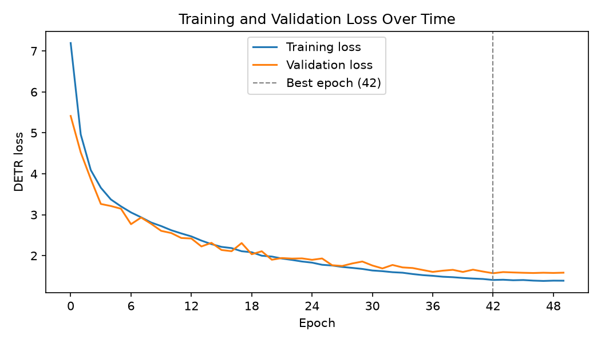

# GalaxyDETR training report: `galaxy_detr_20261108_141353`

## Results

| | |
|---|---|
| **Test accuracy** (held out, scored once) | **0.8410** |
| Test mean box GIoU | 0.9221 |
| Validation accuracy (picked the checkpoint) | 0.8362 |
| Validation mean box GIoU (top query vs. pseudo-label box) | 0.9213 |
| Best epoch | 42 of 50 (0-indexed) |
| Best validation loss | 1.57107 |
| Average time per epoch | 107.4 s |
| Total training time | 89.5 min |
| Saved weights | `models/galaxy_detr_20261108_141353.pth` |

## Setup

| | |
|---|---|
| Date | 2026-11-08 14:13 |
| Device | NVIDIA L40S |
| Dataset | `data/Galaxy10_DECals.h5` |
| Train / validation / test images | 12414 / 2661 / 2661 (stratified, seed 42) |
| Input size | whole 256 x 256 image |
| Training augmentation | random H/V flips, random 90-degree rotations (training split only) |
| Batch sampling (training) | plain shuffle (natural class mix) |
| Backbone | mobilenetv4_conv_small (ImageNet-pretrained) |
| Transformer | d_model 128, 4 heads, 3 enc + 3 dec layers, FFN 512, 10 queries |
| Trainable parameters | 2,699,375 |
| Epochs / batch size | 50 / 32 |
| Learning rate (backbone / rest) | 0.0001 / 0.0003 |

## Test set (held out)

Never used for training or for choosing the checkpoint; scored once at the end. This is the number to report.

Accuracy **0.8410**, mean box GIoU 0.9221, 2661 images.

| Class | Images | Precision | Recall |
|---|---|---|---|
| disturbed | 162 | 0.709 | 0.346 |
| merging | 278 | 0.873 | 0.867 |
| round_smooth | 397 | 0.905 | 0.965 |
| in_between_round_smooth | 304 | 0.889 | 0.924 |
| cigar_smooth | 50 | 0.750 | 0.840 |
| barred_spiral | 307 | 0.892 | 0.857 |
| unbarred_tight_spiral | 274 | 0.813 | 0.715 |
| unbarred_loose_spiral | 394 | 0.670 | 0.789 |
| edge_on_no_bulge | 214 | 0.910 | 0.939 |
| edge_on_with_bulge | 281 | 0.910 | 0.940 |

Confusion matrix (rows = true class, columns = predicted class):

| true \ pred | 0 | 1 | 2 | 3 | 4 | 5 | 6 | 7 | 8 | 9 |
|---|---|---|---|---|---|---|---|---|---|---|
| 0 disturbed | 56 | 4 | 14 | 14 | 4 | 8 | 1 | 50 | 6 | 5 |
| 1 merging | 3 | 241 | 7 | 5 | 0 | 4 | 0 | 11 | 0 | 7 |
| 2 round_smooth | 1 | 2 | 383 | 0 | 0 | 1 | 7 | 3 | 0 | 0 |
| 3 in_between_round_smooth | 3 | 5 | 2 | 281 | 5 | 0 | 2 | 6 | 0 | 0 |
| 4 cigar_smooth | 1 | 0 | 0 | 1 | 42 | 1 | 0 | 1 | 1 | 3 |
| 5 barred_spiral | 0 | 4 | 1 | 3 | 2 | 263 | 5 | 26 | 2 | 1 |
| 6 unbarred_tight_spiral | 1 | 3 | 14 | 5 | 2 | 1 | 196 | 50 | 2 | 0 |
| 7 unbarred_loose_spiral | 11 | 12 | 2 | 6 | 0 | 15 | 30 | 311 | 3 | 4 |
| 8 edge_on_no_bulge | 1 | 1 | 0 | 0 | 0 | 0 | 0 | 5 | 201 | 6 |
| 9 edge_on_with_bulge | 2 | 4 | 0 | 1 | 1 | 2 | 0 | 1 | 6 | 264 |

## Validation set

Used every epoch to pick the best checkpoint, so its accuracy is slightly optimistic.

Accuracy **0.8362**, mean box GIoU 0.9213, 2661 images.

| Class | Images | Precision | Recall |
|---|---|---|---|
| disturbed | 162 | 0.653 | 0.290 |
| merging | 278 | 0.892 | 0.888 |
| round_smooth | 397 | 0.931 | 0.955 |
| in_between_round_smooth | 304 | 0.868 | 0.931 |
| cigar_smooth | 50 | 0.704 | 0.760 |
| barred_spiral | 307 | 0.883 | 0.834 |
| unbarred_tight_spiral | 275 | 0.788 | 0.745 |
| unbarred_loose_spiral | 394 | 0.658 | 0.777 |
| edge_on_no_bulge | 213 | 0.915 | 0.915 |
| edge_on_with_bulge | 281 | 0.906 | 0.957 |

Confusion matrix (rows = true class, columns = predicted class):

| true \ pred | 0 | 1 | 2 | 3 | 4 | 5 | 6 | 7 | 8 | 9 |
|---|---|---|---|---|---|---|---|---|---|---|
| 0 disturbed | 47 | 2 | 10 | 25 | 5 | 11 | 3 | 53 | 2 | 4 |
| 1 merging | 1 | 247 | 4 | 5 | 0 | 1 | 1 | 15 | 2 | 2 |
| 2 round_smooth | 1 | 2 | 379 | 1 | 0 | 3 | 5 | 6 | 0 | 0 |
| 3 in_between_round_smooth | 1 | 6 | 0 | 283 | 5 | 0 | 4 | 5 | 0 | 0 |
| 4 cigar_smooth | 0 | 2 | 0 | 5 | 38 | 0 | 0 | 0 | 1 | 4 |
| 5 barred_spiral | 5 | 3 | 2 | 1 | 2 | 256 | 5 | 28 | 1 | 4 |
| 6 unbarred_tight_spiral | 1 | 4 | 8 | 3 | 1 | 5 | 205 | 46 | 1 | 1 |
| 7 unbarred_loose_spiral | 12 | 6 | 3 | 2 | 2 | 13 | 36 | 306 | 6 | 8 |
| 8 edge_on_no_bulge | 2 | 3 | 1 | 0 | 1 | 1 | 1 | 4 | 195 | 5 |
| 9 edge_on_with_bulge | 2 | 2 | 0 | 1 | 0 | 0 | 0 | 2 | 5 | 269 |

## Per-epoch losses

| Epoch | Train loss | Val loss | Time (s) | |
|---|---|---|---|---|
| 0 | 7.19418 | 5.41297 | 123 | best so far |
| 1 | 4.96164 | 4.52260 | 118 | best so far |
| 2 | 4.09131 | 3.87109 | 120 | best so far |
| 3 | 3.65934 | 3.26295 | 121 | best so far |
| 4 | 3.37272 | 3.21269 | 119 | best so far |
| 5 | 3.20486 | 3.14673 | 119 | best so far |
| 6 | 3.05614 | 2.76922 | 115 | best so far |
| 7 | 2.93785 | 2.93136 | 120 |  |
| 8 | 2.81018 | 2.77787 | 119 |  |
| 9 | 2.72301 | 2.60569 | 116 | best so far |
| 10 | 2.62144 | 2.55304 | 121 | best so far |
| 11 | 2.54324 | 2.43161 | 115 | best so far |
| 12 | 2.47057 | 2.41906 | 120 | best so far |
| 13 | 2.36823 | 2.22533 | 116 | best so far |
| 14 | 2.28167 | 2.31277 | 124 |  |
| 15 | 2.21480 | 2.13858 | 115 | best so far |
| 16 | 2.18496 | 2.10895 | 115 | best so far |
| 17 | 2.10802 | 2.30800 | 113 |  |
| 18 | 2.08344 | 2.03492 | 91 | best so far |
| 19 | 1.99864 | 2.10724 | 89 |  |
| 20 | 1.97848 | 1.90066 | 88 | best so far |
| 21 | 1.93006 | 1.94215 | 90 |  |
| 22 | 1.89632 | 1.92875 | 90 |  |
| 23 | 1.85708 | 1.93349 | 89 |  |
| 24 | 1.82955 | 1.89862 | 89 | best so far |
| 25 | 1.77717 | 1.93151 | 90 |  |
| 26 | 1.75959 | 1.76657 | 89 | best so far |
| 27 | 1.72450 | 1.74828 | 89 | best so far |
| 28 | 1.70132 | 1.80966 | 89 |  |
| 29 | 1.67570 | 1.85687 | 89 |  |
| 30 | 1.63767 | 1.75955 | 88 |  |
| 31 | 1.62085 | 1.68835 | 84 | best so far |
| 32 | 1.59636 | 1.77282 | 84 |  |
| 33 | 1.58346 | 1.71323 | 84 |  |
| 34 | 1.55118 | 1.69810 | 85 |  |
| 35 | 1.52477 | 1.65081 | 84 | best so far |
| 36 | 1.50774 | 1.60334 | 86 | best so far |
| 37 | 1.48542 | 1.63325 | 90 |  |
| 38 | 1.47388 | 1.65409 | 90 |  |
| 39 | 1.45522 | 1.60212 | 90 | best so far |
| 40 | 1.44121 | 1.65789 | 88 |  |
| 41 | 1.43009 | 1.61205 | 89 |  |
| 42 | 1.40618 | 1.57107 | 124 | best so far |
| 43 | 1.41218 | 1.59910 | 139 |  |
| 44 | 1.39954 | 1.58989 | 132 |  |
| 45 | 1.40498 | 1.58180 | 136 |  |
| 46 | 1.39044 | 1.57642 | 149 |  |
| 47 | 1.38250 | 1.58311 | 148 |  |
| 48 | 1.38966 | 1.57794 | 147 |  |
| 49 | 1.38830 | 1.58421 | 151 |  |

Full config: [`config.yaml`](config.yaml). Machine-readable numbers: [`metrics.json`](metrics.json).
